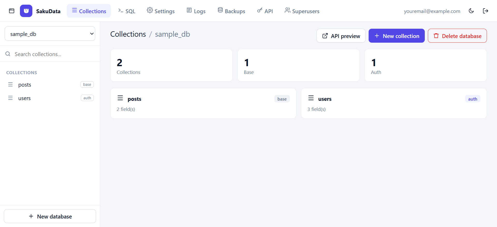
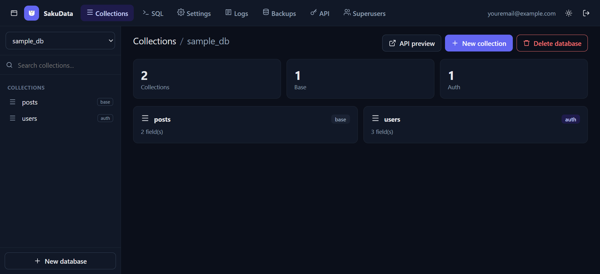

<p align="center">
  
</p>

<h1 align="center">SakuData</h1>

<p align="center">
  Backend self-hosted terinspirasi PocketBase untuk banyak database SQLite terisolasi.
</p>

<p align="center">
  <a href="README.md">English</a> ·
  <a href="docs/API.id.md">Referensi API</a> ·
  <a href="docs/API.md">API reference (EN)</a>
</p>

---

SakuData adalah satu binary Go yang menjalankan banyak database SQLite
independen. Setiap database punya collection, record, user auth, API rules,
file, dan snapshot terjadwal sendiri. Admin UI berupa SPA vanilla JS yang
di-embed ke binary (tanpa build step Node).

## Tangkapan layar

<p align="center">
  
  
</p>

<p align="center"><em>UI admin dalam tema terang dan gelap.</em></p>

## Daftar isi

- [Tangkapan layar](#tangkapan-layar)
- [Fitur](#fitur)
- [Arsitektur](#arsitektur)
- [Kebutuhan](#kebutuhan)
- [Quick start](#quick-start)
- [Konfigurasi](#konfigurasi)
- [Autentikasi](#autentikasi)
- [Collection dan tipe field](#collection-dan-tipe-field)
- [API rules dan filter](#api-rules-dan-filter)
- [API record](#api-record)
- [File](#file)
- [Realtime dan webhook](#realtime-dan-webhook)
- [API token](#api-token)
- [SQL console](#sql-console)
- [Backup](#backup)
- [Export dan import](#export-dan-import)
- [Keamanan](#keamanan)
- [Deployment](#deployment)
- [Development](#development)
- [Struktur project](#struktur-project)
- [Lisensi](#lisensi)

## Fitur

- **Multi-database**: buat, ganti, dan hapus database SQLite terisolasi. URL
  memakai ID opaque, bukan nama.
- **Collection**: tipe `base` dan `auth` dengan editor schema visual (tambah,
  urutkan, ubah, hapus field; migrasi tabel aman).
- **Tipe field**: `text`, `number`, `bool`, `json`, `file`, `email`, `url`,
  `date`, `select`, `relation`, `autodate`.
- **API record**: pagination, sort multi-kolom, filter expression, pilih field.
- **API rules per operasi** (`list`, `view`, `create`, `update`, `delete`)
  dengan preset dan builder kondisi visual.
- **Autentikasi**: password argon2id, JWT HS256, user per collection auth,
  superuser, dan API token per database yang bisa dicabut seketika.
- **File**: disk lokal atau object storage S3-compatible.
- **Realtime**: SSE per collection, plus webhook.
- **Backup**: snapshot otomatis, upload S3, retensi, download, dan restore
  bertahap.
- **SQL console** per database untuk superuser (dibatasi baris & waktu).
- **Export/import** record JSON/CSV.
- **Audit log**, settings aplikasi, mail, dan manajemen superuser.
- **UI responsif** dengan tema terang/gelap, sidebar bisa disembunyikan, dan
  logo saku minimal.

## Arsitektur

```
Browser (vanilla ES modules, embedded)
        │
        ▼
Server Go net/http ── middleware (security headers, CORS, rate limit, log)
        │
        ├── /api/admin/*      API superuser (JWT)
        ├── /api/d/{id}/*     API data per database (JWT user, API token)
        └── /_/               SPA admin
        │
        ├── system.db         admin, registry database, settings, log, token
        └── data/dbs/*.db     satu file SQLite per database
            data/files/*      penyimpanan file lokal
            data/backups/*    snapshot lokal
```

- Metadata collection disimpan di `_collections`; tiap collection punya tabel
  `c_<nama>`.
- Perubahan schema membangun ulang tabel SQLite dalam transaksi dan
  mempertahankan data lama.
- Backup menyalin database hidup dengan `VACUUM INTO` agar konsisten.

## Kebutuhan

- Go **1.26+** (HTTP standard library, SQLite pure-Go `modernc.org/sqlite`).
- Tidak perlu CGO, Node.js, atau database eksternal.
- Opsional: bucket S3-compatible (AWS S3, MinIO, R2, B2, …).

## Quick start

```bash
git clone https://github.com/teguh-santoso/sakudata.git
cd sakudata
go run . -addr 127.0.0.1:8090 -data ./data
```

Buka <http://127.0.0.1:8090/_/>. Pada instance baru, UI meminta pembuatan
superuser pertama. Padanan lewat API:

```bash
curl -X POST http://127.0.0.1:8090/api/admin/setup \
  -H "Content-Type: application/json" \
  -d '{"email":"admin@example.com","password":"minimal8karakter"}'
```

Build binary statis:

```bash
CGO_ENABLED=0 go build -trimpath -ldflags="-s -w" -o sakudata .
./sakudata -addr 0.0.0.0:8090 -data /var/lib/sakudata
```

Docker:

```bash
docker compose up -d --build
# atau
docker build -t sakudata .
docker run -p 8090:8090 -v sakudata-data:/data sakudata
```

## Konfigurasi

Flag:

| Flag | Default | Keterangan |
| --- | --- | --- |
| `-addr` | `127.0.0.1:8090` | Alamat listen HTTP |
| `-data` | `./data` | Direktori data |
| `-restore` | – | Restore backup `.tar.gz` ke `-data` lalu keluar |

Settings disimpan di `system.db` dan diedit dari **Settings** / **Backups**:

| Key | Keterangan |
| --- | --- |
| `app_name`, `app_base_url` | Branding dan URL publik |
| `mail_from`, `mail_host`, `mail_port`, `mail_user`, `mail_pass` | Konfigurasi SMTP |
| `s3_enabled`, `s3_endpoint`, `s3_region`, `s3_bucket`, `s3_access`, `s3_secret`, `s3_prefix`, `s3_pathstyle` | Storage S3-compatible |
| `backup_enabled`, `backup_interval_hours`, `backup_keep`, `backup_last` | Backup otomatis |

Secret (`s3_secret`, `mail_pass`) tidak pernah dikembalikan penuh oleh API.

## Autentikasi

### Token superuser

```bash
curl -X POST https://host-anda/api/admin/login \
  -H "Content-Type: application/json" \
  -d '{"email":"admin@example.com","password":"..."}'
```

Respons `{"token":"...","record":{...}}`, berlaku 12 jam. Token superuser
melewati semua API rules dan bisa mengelola semua database.

### Token user collection auth

```bash
curl -X POST https://host-anda/api/d/<DB_ID>/c/<collection>/auth/login \
  -H "Content-Type: application/json" \
  -d '{"identity":"user@example.com","password":"..."}'
```

Berlaku 7 hari, terikat ke database **dan** collection tersebut. User harus
`verified: true`. Refresh:

```bash
curl -X POST https://host-anda/api/d/<DB_ID>/c/<collection>/auth/refresh \
  -H "Authorization: <token-user>"
```

### Mengirim token

```http
Authorization: <token>
# atau
Authorization: Bearer <token>
# API token juga bisa:
X-API-Key: mdb_...
```

Untuk SSE (`/subscribe`), EventSource tidak bisa set header, jadi `?token=`
didukung.

## Collection dan tipe field

Collection punya nama, tipe, dan field. Opsi field:

- `required` — tolak nilai kosong.
- `unique` — buat unique index.
- `options` — nilai yang diizinkan untuk `select`.

`id`, `created`, `updated` adalah kolom sistem. Collection auth wajib punya
field `email` (tipe `text`/`email`) dan `password` (tipe `text`). Password
di-hash argon2id dan tidak pernah dikembalikan API.

## API rules dan filter

| Nilai | Arti |
| --- | --- |
| `""` (kosong) | Hanya superuser |
| `*` | Publik |
| `user` | Semua user login di database + collection yang sama |
| ekspresi | Filter per-record, mis. `owner = @request.auth.id` |

Sintaks ekspresi:

- Perbandingan: `=`, `==`, `!=`, `>`, `>=`, `<`, `<=`, `~` (mengandung), `!~`.
- Logika: `&&`, `||`, `!`, tanda kurung.
- Literal: string (`"x"`/`'x'`), angka, `true`, `false`, `null`.
- Konteks request: `@request.auth.id`, `@request.auth.email`,
  `@request.auth.collectionName`.
- Placeholder query: `{:nama}` diambil dari query string.

Identifier divalidasi dan semua nilai di-bind sebagai parameter SQL. UI admin
menyediakan **rule builder** dengan preset dan baris kondisi visual.

## API record

```bash
# list
curl "https://host/api/d/<DB_ID>/c/<collection>/records?page=1&perPage=20&sort=-created,name" \
  -H "Authorization: <token>"

# filter + placeholder
curl -G "https://host/api/d/<DB_ID>/c/<collection>/records" \
  -H "Authorization: <token>" \
  --data-urlencode 'filter=aktif = true && nama ~ "buk"' \
  --data-urlencode 'sort=-harga'

# create / update / delete
curl -X POST "https://host/api/d/<DB_ID>/c/<collection>/records" \
  -H "Authorization: <token>" -H "Content-Type: application/json" \
  -d '{"title":"Halo"}'
```

Parameter: `page`, `perPage` (maks 200), `sort`, `filter`, `fields`,
`skipTotal`.

Envelope respons:

```json
{"page":1,"perPage":20,"totalItems":2,"totalPages":1,"items":[...]}
```

## File

```http
POST   /api/d/{dbID}/c/{col}/records/{id}/files/{field}
GET    /api/d/{dbID}/c/{col}/records/{id}/files/{field}/{name}
DELETE /api/d/{dbID}/c/{col}/records/{id}/files/{field}
```

- Lokal: `data/files/<db>/<collection>/<record>/`.
- S3: atur di **Settings → File storage**.
- Nama file disanitasi; ukuran maksimum 10 MB.

## Realtime dan webhook

- SSE: `GET /api/d/{dbID}/c/{col}/subscribe` (auth header atau `?token=`).
- Webhook per collection: `create`, `update`, `delete` → POST JSON
  `{event, db, collection, record}`.

## API token

Kredensial mesin per database, dibuat dari halaman **API**.

- Scope: akses data penuh (record, file, export/import) ke **satu database**.
- Tidak bisa: mengelola collection/schema, settings, backup, SQL, superuser.
- Token mentah (`mdb_...`) hanya ditampilkan sekali; server menyimpan hash
  SHA-256.
- Revoke langsung berlaku.

```bash
TOKEN=$(curl -s -X POST https://host/api/admin/tokens \
  -H "Authorization: <token-admin>" -H "Content-Type: application/json" \
  -d '{"name":"ci","dbId":"<DB_ID>"}' | jq -r .token)

curl https://host/api/d/<DB_ID>/c/<collection>/records \
  -H "Authorization: $TOKEN"
```

## SQL console

Superuser bisa menjalankan satu statement per request:

```http
POST /api/d/{dbID}/sql
{"query":"SELECT * FROM \"c_posts\" LIMIT 20"}
```

- Statement baca mengembalikan `{type:"query", columns, rows, rowCount, truncated, elapsedMs}`.
- Statement tulis mengembalikan `{type:"exec", rowsAffected, elapsedMs}`.
- Batas: timeout 20 detik, 1000 baris, query 100 KB.
- Hanya token superuser (API token tidak diizinkan).

## Backup

Snapshot berupa tar.gz berisi `system.db`, semua database tenant (via
`VACUUM INTO`), dan folder `files/`. Disimpan di `data/backups/` dan diunggah ke
`<prefix-s3>/backups/` bila S3 aktif.

- Otomatis: aktifkan di halaman Backups; `backup_interval_hours` default 24,
  `backup_keep` default 7 (dipangkas lokal & S3).
- Manual: `POST /api/admin/backups`.
- List/download/hapus: `/api/admin/backups[/{name}]`.
- Restore: `POST /api/admin/backups/{name}/restore` menaruh arsip di
  `data/restore-pending` dan diterapkan saat start berikutnya. Data lama
  disimpan di `restore-old-<timestamp>/`.
- Restore offline: `sakudata -data /var/lib/sakudata -restore backup.tar.gz`.

## Export dan import

```http
GET  /api/d/{dbID}/c/{col}/export?format=json
GET  /api/d/{dbID}/c/{col}/export?format=csv
POST /api/d/{dbID}/c/{col}/import     # array JSON, maks 5000 baris
```

Export mengikuti rule `list` collection dan filter aktif.

## Keamanan

- Password argon2id; JWT ditandatangani secret yang dibuat saat pertama jalan.
- Respons API dan UI admin mengirim `Cache-Control: no-store`.
- Request anonim ke database/collection yang tidak ada mengembalikan `401`,
  sehingga keberadaan resource tidak bocor.
- Endpoint login dibatasi 30 percobaan/menit per IP.
- Security headers, CORS preflight, panic recovery, request log, dan graceful
  shutdown tersedia.
- Secret dimasking pada respons API.
- Jangan commit `.credentials`, `.env`, file key, atau `data/`.

## Deployment

Lihat [`deploy/README.md`](deploy/README.md). Opsi:

- systemd + Caddy (disarankan): `deploy/sakudata.service`, `deploy/Caddyfile`,
  `deploy/deploy.sh`.
- Docker: `Dockerfile` + `docker-compose.yml`.

## Development

```bash
go test ./...
go vet ./...
gofmt -l .
```

UI admin ada di `internal/ui/assets/` dan di-embed dengan `//go:embed`. URL asset
memakai versi (`assets/vN/...`) agar cache CDN tidak menyajikan modul lama.

## Struktur project

```
main.go                     entry point, flag, restore saat start
internal/api/               route HTTP, handler, middleware, backup, SQL
internal/auth/              argon2id dan JWT
internal/backup/            pembuatan/daftar/ekstrak snapshot tar.gz
internal/rules/             parser filter/rule dan compiler SQL
internal/store/             system.db: admin, database, settings, log, token
internal/tenant/            manajer per-database, migrasi schema, record,
                            storage file (lokal/S3), hub realtime
internal/ui/assets/         SPA admin (vanilla ES modules)
docs/                       logo, referensi API (EN/ID)
deploy/                     systemd, Caddy, skrip deploy, panduan deployment
```

## Lisensi

Apache License 2.0. Lihat [LICENSE](LICENSE).
